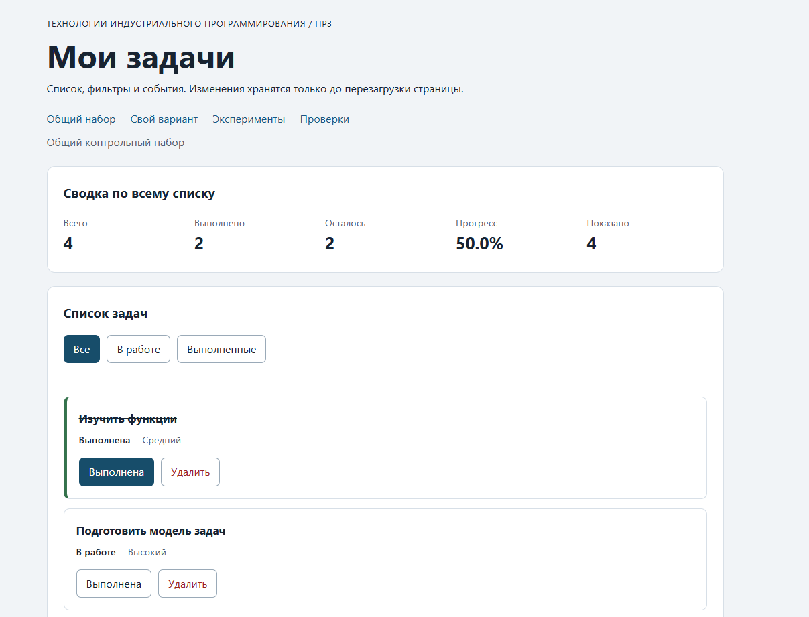

# Отчёт по практической работе № 2

**Тема:** Функции, объекты, массивы и организация кода

## 1. Автор и окружение

- Имя: Екатерина Амосова
- Группа: ЭФБО-05-25
- Вариант: 1 (номер в журнале 17: ((17 − 1) % 8) + 1 = 1)
- Операционная система: Windows
- Node.js: v24.21.0


## Запуск

Рабочая папка: `practice-03` внутри личного репозитория.

```bash
npm run check:service
npm start
```

Устанавливать зависимости через `npm install` не требуется. Для PowerShell при блокировке `npm.ps1` доступны `npm.cmd` и прямые команды `node`.

```text
http://127.0.0.1:5503/
http://127.0.0.1:5503/index.html?dataset=variant
http://127.0.0.1:5503/examples/dom-events.html
http://127.0.0.1:5503/checks.html
```

Остановка сервера: `Ctrl+C`. Если выбран другой порт, указать фактическую команду и адрес.

## Что перенесено из ПР2

В `src/task-service.js` и `src/data.js` перенесены собственные реализации из ПР2. Повторная проверка через `npm run check:service` показала 35 пройденных сценариев и 0 ошибок. Модуль `main.js` из ПР2 не переносился, так как в ПР3 он реализует управление интерфейсом, а не консольный сценарий.

## Эксперименты

| № | До запуска: прогноз | После запуска: результат | Объяснение |
|---:|---|---|---|
| 1. Отсутствующий элемент и коллекция | null и 0 | Отсутствующий элемент: null, Пустая коллекция: 0 | querySelector при отсутствии даёт null; querySelectorAll даёт пустой NodeList длиной 0 |
| 2. dataset и числовой id | строка "23", потом число 23 | dataset.taskId: 23 string, Числовой id: 23 | dataset отдаёт строку, Number(...) превращает в число |
| 3. Статический NodeList | initialItems не растёт, новый querySelectorAll растёт | Старый: 1 дважды, Новый: 2, потом 3 | querySelectorAll возвращает статический NodeList - «снимок» на момент вызова. Добавление узлов его не обновляет, нужен новый запрос |
| 4. Строка с HTML-разметкой | В заголовке отобразится текст `<strong>Это текст, а не HTML</strong>`, HTML-элемент не создастся | Заголовок показывает строку с угловыми скобками. `#lab-title.children.length` → `0`; `textContent` содержит разметку как текст |  Используется `textContent`, а не `innerHTML`. HTML не парсится: символы `<` и `>` выводятся как текст, тег `<strong>` не создаётся. Это защищает от XSS при выводе пользовательских названий задач  |
| 5. Распространение события | При клике по вложенному `span` обработчики вызовутся на трёх уровнях: захват на `#lab-card`, затем на `#lab-button`, затем всплытие на `#lab-card`. `event.target` — `span#lab-label`, `event.currentTarget` меняется | Вывод: `1. phase=1; target=lab-label; currentTarget=lab-card`; `2. phase=2; target=lab-label; currentTarget=lab-button`; `3. phase=3; target=lab-label; currentTarget=lab-card` | Событие `click` распространяется по трём фазам: захват (сверху вниз) → цель → всплытие (снизу вверх). `event.target` — исходный элемент, на который пришёлся клик (`span`). `event.currentTarget` — элемент, на котором сейчас выполняется обработчик. Именно поэтому делегирование через `closest("button[data-action]")` находит кнопку даже при клике по `span` |

## Организация кода

- `task-service.js` — чистые прикладные функции ПР2 (без DOM).
- `task-selectors.js` — функция `getVisibleTasks` для отбора задач по фильтру без изменения исходного массива.
- `task-view.js` — создание DOM-элементов (карточки, список), обновление сводки и пустого состояния.
- `main.js` — хранение состояния (`currentTasks`, `currentFilter`), обработка событий через делегирование и вызов `renderApp()`.

Полный список задач хранится в `currentTasks`, выбранный фильтр — в `currentFilter`. События обрабатываются в `main.js` на контейнерах списка и фильтров. Сводка рассчитывается в `task-service.js` и выводится в `task-view.js`.

## Общий сценарий

Ожидания находятся в разделе 6.5 методички. Ниже записываются фактические результаты запуска.

| Шаг | Видимые id | Всего | Выполнено | Осталось | Прогресс | Показано | Сообщение | Совпало с ожиданием |
|---:|---|---|---|---|---|---|---|---|
| 0 | [1, 4, 7, 10] | 4 | 2 | 2 | 50.0% | 4 | - | Да |
| 1 | [4, 7] | 4 | 2 | 2 | 50.0% | 2 | - | Да |
| 2 | [7] | 4 | 3 | 1 | 75.0% | 1 | - | Да |
| 3 | [1, 4, 7, 10] | 4 | 3 | 1 | 75.0% | 4 | - | Да |
| 4 | [1, 4, 10] | 3 | 3 | 0 | 100.0% | 3 | - | Да |
| 5 | [] | 3 | 3 | 0 | 100.0% | 0 | «Нет задач по выбранному фильтру.» | Да |
| 6 | [1, 4, 10] | 3 | 2 | 1 | 66.7% | 3 | - | Да |
| 7 |

## Протокол проверки сервиса

```text
OK: 01. Создание задачи с явным приоритетом
OK: 02. Приоритет по умолчанию
OK: 03. Удаление краевых пробелов без изменения внутренних
OK: 04. Граничные длины названия и положительный безопасный id
OK: 05. Некорректные названия при создании
OK: 06. Некорректные идентификаторы при создании
OK: 07. Все допустимые приоритеты и отклонение недопустимых
OK: 08. Каждый вызов createTask возвращает новый объект
OK: 09. Поиск по id, а не по индексу
OK: 10. Отсутствующая задача и пустой массив при поиске
OK: 11. Поиск не преобразует строковый id в число
OK: 12. Получение невыполненных задач
OK: 13. Пустой список, все выполнены и все не выполнены
OK: 14. Названия в исходном порядке и пустой список
OK: 15. Сводка по общему набору
OK: 16. Сводка по пустому списку
OK: 17. Сводка: ничего не выполнено и выполнено всё
OK: 18. Процент остаётся числом без предварительного округления
OK: 19. Добавление в конец без изменения входного массива
OK: 20. Добавление в пустой список с приоритетом по умолчанию
OK: 21. Повторяющийся id отклоняется
OK: 22. Добавление не обходит проверки createTask
OK: 23. Изменение completed в обе стороны
OK: 24. completed принимает только boolean
OK: 25. Некорректный или отсутствующий id при изменении статуса
OK: 26. Повторная установка статуса создаёт новый результат
OK: 27. Переименование сохраняет остальные поля
OK: 28. Проверки названия при переименовании
OK: 29. Некорректный или отсутствующий id при переименовании
OK: 30. Удаление по id с сохранением порядка
OK: 31. Удаление единственной записи
OK: 32. Некорректный, отсутствующий id и удаление из пустого списка
OK: 33. Входные объекты не изменяются ни одной операцией
OK: 34. Общий сценарий и все промежуточные сводки
OK: 35. Работа с другим набором, без зависимости от demoTasks

Проверок пройдено: 35; не пройдено: 0.
```

## Протокол браузерных проверок

Вставить **реальный текст** из блока «Текстовый протокол» на `checks.html`.

```text
OK: Фильтр pending выбирает невыполненные задачи
OK: Фильтр completed выбирает выполненные задачи
OK: Все три фильтра работают с пустым списком
OK: Фильтрация не меняет входные записи и их порядок
OK: Карточка — li.task-card с числовым id в dataset
OK: Статус невыполненной карточки и aria-pressed согласованы
OK: Статус выполненной карточки и aria-pressed согласованы
OK: В карточке две обычные кнопки с вложенными подписями
OK: Все приоритеты отображаются по установленному словарю
OK: Название с разметкой отображается текстом
OK: Отрисовка списка создаёт карточки в исходном порядке
OK: Повторная отрисовка не накапливает карточки
OK: Контейнер списка и его обработчик сохраняются
OK: Отрисовка пустого массива очищает прежние карточки
OK: Сводка считается по всему списку, отдельно выводится Показано
OK: Пустая сводка не содержит NaN и Infinity
OK: Сообщение для полностью пустого списка
OK: Сообщение для пустого результата фильтра
OK: Появление карточек скрывает прежнее пустое состояние
OK: Приложение: начальный набор и сводка
OK: Приложение: фильтр срабатывает по клику на вложенный span
OK: Приложение: активный фильтр отмечен классом и aria-pressed
OK: Приложение: фильтрация не удаляет скрытые задачи
OK: Приложение: переключение по id, а не индексу массива
OK: Приложение: выполненная задача исчезает из фильтра В работе
OK: Приложение: удаление изменяет данные, а не только DOM
OK: Приложение: клик по названию не изменяет данные
OK: Приложение: после перерисовок одно нажатие — одно изменение
OK: Приложение: удаление всех записей и нулевая сводка
OK: Приложение: нет совпадений — не то же самое, что нет задач
OK: Приложение: неизвестный числовой id не меняет данные
OK: Приложение: id 4abc не превращается в 4
OK: Приложение: неизвестное действие игнорируется
OK: Приложение: после изменения сохраняется клавиатурный фокус
OK: Приложение: новая загрузка возвращает исходное состояние

Всего: 36. Пройдено: 36. Ошибок: 0.
```

## Собственные проверки

| № | Исходное состояние и действия | Ожидаемый результат | Фактический результат | Итог |
|---:|---|---|---|---|
| 1 | В исходном наборе удалить три задачи,оставив только `id = 4`. Нажать «Выполнена» на ней, затем «Удалить» | Прогресс `100.0%`, затем пустой список, сообщение «Список задач пуст.», сводка `0 / 0 / 0 / 0.0%` | Совпадает | Пройдено  |
| 2 | На фильтре «В работе» отметить выполненными обе задачи (`id = 4` и `id = 7`). Переключиться на «Выполненные» |  В «В работе» — 0 задач и сообщение «Нет задач по выбранному фильтру.». В «Выполненные» — 4 задачи, прогресс `100.0%` | Совпадает | Пройдено  |
| 3 | В Console заменить название первой задачи на `<strong>Проверка</strong> & "кавычки"`. Пять раз подряд нажать «Выполнена» |  Название выводится текстом с угловыми скобками. После 5 переключений статус меняется один раз (нечётное число). В DOM ровно 4 карточки, дублей нет | Совпадает | Пройдено  |

Минимум один случай — граничное состояние, один — событие или повторная отрисовка.

## Отладка и клавиатура

При отладке через Console зафиксированы значения в момент клика на кнопку «Выполнена»:

- `event.target` — `SPAN.action-label` (нажатие пришлось на вложенный текст, а не на саму кнопку);
- `event.currentTarget` — `UL#task-list` (обработчик висит на контейнере списка);
- `dataset.taskId` — `"4"` (строка, все атрибуты `data-*` всегда строки);
- числовой `id` — `4` (получен через `Number(...)`, прошёл `Number.isSafeInteger`);
- действие — `toggle` (из `data-action`);
- результат сервиса — `{ ok: true, tasks: [...] }`, новый массив сохранён в `currentTasks`.

Это подтверждает, что событие всплывает от `span` до `ul`, а `closest("button[data-action]")` находит кнопку даже при клике по вложенной подписи.

**Клавиатура.** Tab последовательно переводит фокус на кнопки карточек и фильтры. Enter и Space активируют кнопку, как и клик мышью. После изменения статуса фокус возвращается на ту же кнопку «Выполнена» через `restoreTaskFocus(id, action)`. Если карточка исчезает (удаление или смена фильтра), фокус переходит на активный фильтр.

**Проверка отказа.** После изменения `data-task-id="4"` на `"777"` через Console и нажатия «Удалить» появилось сообщение «Задача не найдена», массив задач не изменился. Аналогично для значения `"4abc"` — сообщение «Некорректный идентификатор задачи» (потому что `Number("4abc")` даёт `NaN`, а `Number.isSafeInteger(NaN)` — `false`). Выбор фильтра «Все» пересоздаёт карточки из актуального массива и очищает сообщение.

## Вид приложения



## Дополнительное задание

Не выполнено.

## Вывод

В ходе работы изучены методы взаимодействия с DOM (`querySelector`, `createElement`, `textContent`), механизм всплытия событий и делегирование через `closest`. Данные (`currentTasks`) отделены от их представления (`task-view.js`), изменение состояния происходит только через функции ПР2, а не через прямое изменение DOM. Фильтрация не удаляет задачи, а лишь меняет видимую выборку (`getVisibleTasks`), поэтому скрытые записи не теряются. Для защиты от XSS названия задач выводятся через `textContent`, а не `innerHTML`. Все 35 проверок сервиса и 36 браузерных проверок пройдены успешно. Общий и индивидуальный сценарии совпали с ожидаемыми результатами