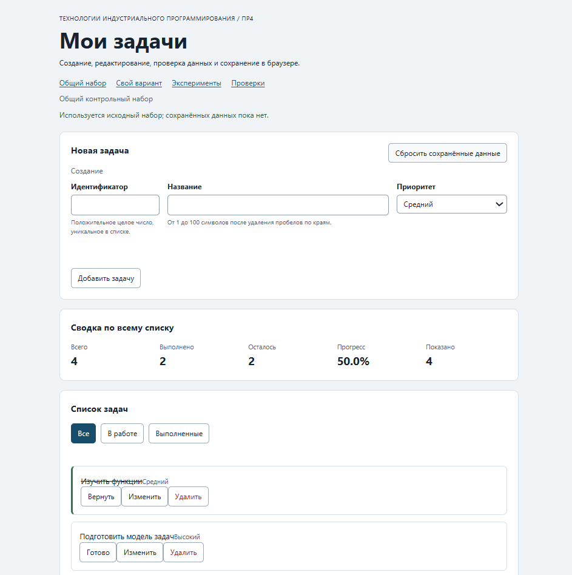

# Отчёт по практической работе № 4

**Тема:** Формы, валидация и локальное хранение данных

## 1. Автор и окружение

- Имя: Екатерина Амосова
- Группа: ЭФБО-05-25
- Вариант: 1 (номер в журнале 17: ((17 − 1) % 8) + 1 = 1)
- Операционная система: Windows
- Node.js: v24.21.0
## 2. Запуск
Рабочая папка: `practice-04`. Запуск сервера выполняется командой `npm start`. Адрес приложения: `http://127.0.0.1:5504/`.

## 3. Перенос результата ПР3
| Файл | Что перенесено или изменено |
|---|---|
| `data.js` | Перенесен исходный массив `demoTasks` и данные варианта. |
| `task-service.js` | Перенесены функции бизнес-логики, добавлена функция `updateTask`. |
| `task-selectors.js` | Перенесена функция `getVisibleTasks` (фильтрация). |
| `task-view.js` | Перенесен код отрисовки карточек и добавлена кнопка `edit`. |

## 4. Эксперименты с формой и хранилищем
| № | До запуска: прогноз | После запуска: результат | Объяснение |
|---|---|---|---|
| 1 | Пустое обязательное поле | Отказ (сообщение «Заполните это поле») | Сработала встроенная HTML5-валидация (атрибут `required`). |
| 2 | Название из пробелов | Отказ, ошибка в журнале | Прикладная валидация отсекает пробелы через метод `trim()`. |
| 3 | Типы значений FormData | Строки (`string`) | `FormData` всегда возвращает строки, числа нужно приводить вручную. |
| 4 | Строка в localStorage | JSON-строка в кавычках | `localStorage` хранит только строки, используется `JSON.stringify`. |
| 5 | Поврежденный JSON | Выведена ошибка, приложение не упало | Ошибка перехвачена блоком `try...catch`. |

## 5. Организация кода
* **`task-service.js`** — бизнес-логика (создание, удаление, редактирование задач). Не зависит от DOM.
* **`form-validation.js`** — чистая валидация полей формы (проверка id, названия, приоритета).
* **`task-storage.js`** — работа с `localStorage` (сохранение, загрузка, проверка схемы).
* **`task-view.js`** — создание DOM-элементов и отрисовка списка.
* **`main.js`** — связывает все модули, обрабатывает клики и обновляет интерфейс.

*Ответ на вопрос:* Функции хранилища получают `storage` аргументом, чтобы код был независимым от браузера. Это позволяет использовать `localStorage` в реальной жизни и подменять его обычным объектом в тестах. Данные из JSON проверяются до использования, чтобы избежать ошибок при поврежденных данных.

## 6. Проверка формы
| Сценарий | Ожидаемый результат | Фактический результат | Итог |
|---|---|---|---|
| Добавление корректной задачи | Успех | Задача добавлена | ОК |
| Повторяющийся id | Отказ без изменения списка | Ошибка валидации | ОК |
| Пустое название | Отказ | Ошибка валидации | ОК |
| Название из пробелов | Отказ | Ошибка после trim() | ОК |
| Название длиной 100 | Успех | Успех | ОК |
| Название длиной 101 | Отказ | Ошибка валидации | ОК |
| Редактирование title и priority | Меняется одна задача | Изменения применены | ОК |
| Отмена редактирования | Возврат к пустой форме | Форма очищена | ОК |

## 7. Общий сценарий
| Шаг | Действие | Видимые id | Всего | Выполнено | Осталось | Прогресс |
|---|---|---|---|---|---|---|
| 0 | Исходный запуск | [1, 4, 7, 10] | 4 | 2 | 2 | 50.0% |
| 1 | Добавление id=20 | [1, 4, 7, 10, 20] | 5 | 2 | 3 | 40.0% |
| 2 | Отказ для id=4 | Без изменений | 5 | 2 | 3 | 40.0% |
| 3 | Редактирование id=4 | Те же id | 5 | 2 | 3 | 40.0% |
| 4 | Переключение id=7 | Те же id | 5 | 3 | 2 | 60.0% |
| 5 | Удаление id=1 | [4, 7, 10, 20] | 4 | 2 | 2 | 50.0% |
| 6 | Перезагрузка страницы | [4, 7, 10, 20] | 4 | 2 | 2 | 50.0% |
| 7 | Сброс данных | [1, 4, 7, 10] | 4 | 2 | 2 | 50.0% |

## 8. Проверка восстановления и ошибок
| Случай | Ожидание | Фактический результат | Итог |
|---|---|---|---|
| Записей нет | Используется исходный набор | Исходный набор | ОК |
| Корректная запись | Восстанавливается после перезагрузки | Восстановлено | ОК |
| Поврежденный JSON | Запускается с исходным набором | Предупреждение, данные исходные | ОК |
| Неверная версия или схема | Исходный набор и предупреждение | Сработал fallback | ОК |
| Сброс | Удаляется только текущий ключ | Удален | ОК |
| Общий/индивидуальный | Изменения не смешиваются | Разные ключи | ОК |

## 9. Индивидуальный вариант
| Этап | Всего | Выполнено | Осталось | Прогресс | Видимые id |
|---|---|---|---|---|---|
| Исходный набор | 6 | 0 | 6 | 0.0% | [11, 23, 37, 41, 58, 64] |
| После добавления 75 | 7 | 0 | 7 | 0.0% | [11, 23, 37, 41, 58, 64, 75] |
| После редактирования 23 | 7 | 0 | 7 | 0.0% | [11, 23, 37, 41, 58, 64, 75] |
| После удаления 37 | 6 | 0 | 6 | 0.0% | [11, 23, 41, 58, 64, 75] |
| После перезагрузки | 6 | 0 | 6 | 0.0% | [11, 23, 41, 58, 64, 75] |
| После сброса | 6 | 0 | 6 | 0.0% | [11, 23, 37, 41, 58, 64] |

## 10. Протоколы проверок
### Протокол проверок сервиса (`npm test`)
```text
(Вставьте сюда лог из терминала, где OK: 01 ... OK: 35 и Проверок пройдено: 35; не пройдено: 0)

## Протокол проверок сервиса

Вставить реальный вывод `npm run check:service`.

```text
OK: 01. Создание задачи с явным приоритетом
OK: 02. Приоритет по умолчанию
OK: 03. Удаление краевых пробелов без изменения внутренних
OK: 04. Граничные длины названия и положительный безопасный id
OK: 05. Некорректные названия при создании
OK: 06. Некорректные идентификаторы при создании
OK: 07. Все допустимые приоритеты и отклонение недопустимых
OK: 08. Каждый вызов createTask возвращает новый объект
OK: 09. Поиск по id, а не по индексу
OK: 10. Отсутствующая задача и пустой массив при поиске
OK: 11. Поиск не преобразует строковый id в число
OK: 12. Получение невыполненных задач
OK: 13. Пустой список, все выполнены и все не выполнены
OK: 14. Названия в исходном порядке и пустой список
OK: 15. Сводка по общему набору
OK: 16. Сводка по пустому списку
OK: 17. Сводка: ничего не выполнено и выполнено всё
OK: 18. Процент остаётся числом без предварительного округления
OK: 19. Добавление в конец без изменения входного массива
OK: 20. Добавление в пустой список с приоритетом по умолчанию
OK: 21. Повторяющийся id отклоняется
OK: 22. Добавление не обходит проверки createTask
OK: 23. Изменение completed в обе стороны
OK: 24. completed принимает только boolean
OK: 25. Некорректный или отсутствующий id при изменении статуса
OK: 26. Повторная установка статуса создаёт новый результат
OK: 27. Переименование сохраняет остальные поля
OK: 28. Проверки названия при переименовании
OK: 29. Некорректный или отсутствующий id при переименовании
OK: 30. Удаление по id с сохранением порядка
OK: 31. Удаление единственной записи
OK: 32. Некорректный, отсутствующий id и удаление из пустого списка
OK: 33. Входные объекты не изменяются ни одной операцией
OK: 34. Общий сценарий и все промежуточные сводки
OK: 35. Работа с другим набором, без зависимости от demoTasks

Проверок пройдено: 35; не пройдено: 0.
```

## Протокол проверок новых модулей

Вставить реальный вывод `npm run check:modules`.

```text
OK: 01. updateTask изменяет название и приоритет выбранной задачи
OK: 02. updateTask нормализует название и сохраняет completed
OK: 03. updateTask не изменяет входной массив и объекты
OK: 04. updateTask отклоняет некорректный и отсутствующий id
OK: 05. updateTask отклоняет некорректные название и приоритет
OK: 06. Валидация создания нормализует поля
OK: 07. Валидация отклоняет некорректные id
OK: 08. Валидация отклоняет повторяющийся id при создании
OK: 09. Валидация проверяет название после trim
OK: 10. Валидация принимает только три приоритета
OK: 11. В режиме редактирования используется editingId
OK: 12. Редактирование отсутствующей задачи отклоняется
OK: 13. Валидация не изменяет draft и список
OK: 14. Проверка схемы принимает корректный список
OK: 15. Проверка схемы отклоняет неверную структуру
OK: 16. Отсутствующая запись возвращает независимую копию исходных данных
OK: 17. Корректная запись восстанавливается из хранилища
OK: 18. Повреждённый JSON приводит к безопасному fallback
OK: 19. Неизвестная версия приводит к безопасному fallback
OK: 20. Некорректные задачи из JSON не принимаются
OK: 21. Ошибка getItem перехватывается
OK: 22. Сохранение записывает версию и задачи
OK: 23. Некорректный список не записывается
OK: 24. Ошибка setItem перехватывается
OK: 25. Удаляется только переданный ключ
OK: 26. Ошибка removeItem перехватывается
OK: 27. Результат загрузки не разделяет объекты с fallback

Проверок пройдено: 27; не пройдено: 0.
```

## Протокол браузерных проверок

Вставить реальный текст из блока «Текстовый протокол» на `checks.html`.

```text
OK: Фильтры ПР3 сохраняют порядок и не изменяют вход
OK: Карточка содержит toggle, edit и delete
OK: Название задачи выводится как текст
OK: Повторная отрисовка списка не накапливает карточки
OK: Сводка использует полный список и отдельный visibleCount
OK: Пустые состояния различают список и фильтр
OK: Приложение запускается с исходным набором
OK: Корректная форма добавляет задачу и сохраняет данные
OK: Повторяющийся id отклоняется без записи
OK: Название из пробелов отклоняется прикладной проверкой
OK: Нативныеограничения не пропускают пустую форму
OK: Кнопка edit заполняет форму и блокирует id
OK: Редактирование меняет title и priority, сохраняя completed
OK: Отмена редактирования возвращает режим создания
OK: Успешная отправка очищает ошибки и форму
OK: Изменение статуса сохраняется
OK: Удаление сохраняется
OK: Фильтр не записывается, но сохраняется после изменения данных
OK: Перезагрузка восстанавливает сохранённые задачи
OK: Сброс удаляет ключ и восстанавливает исходный набор
OK: Повреждённый JSON не ломает запуск
OK: Некорректная схема из storage заменяется исходным набором
OK: Общий и индивидуальный наборы используют разные ключи

Всего: 23. Пройдено: 23. Ошибок: 0.
```

## Собственные проверки

| № | Исходное состояние и действия | Ожидаемый результат | Фактический результат | Итог |
|---:|---|---|---|---|
| 1 | Форма создания, ввести id=30 и название ровно из 100 символов (`"a".repeat(100)`). | Успех, задача добавляется. | Задача появилась в конце списка, её название содержит ровно 100 символов, `localStorage` обновился. | Пройдено |
| 2 | Добавить задачу id=20, перезагрузить страницу (F5), открыть фильтр «Все». | Задача id=20 сохраняется и отображается после перезагрузки. | id=20 на месте, статус `completed: false` сохранён. | Пройдено |
| 3 | Через DevTools: `localStorage.setItem("tip-js-practice-04:demo", "{broken-json")`, перезагрузить страницу, затем нажать «Сбросить сохранённые данные». | Приложение запускается с исходными 4 задачами и предупреждением. Сброс очищает повреждённый ключ. | Список исходный (4 задачи), статус-бар показывает ошибку в жёлтой рамке, кнопка сброса удаляет ключ, восстанавливает исходный набор. | Пройдено |

## Отладка и клавиатура

Точка останова в `handleFormSubmit`. При отправке формы с `id=20`:
- `draft` = `{ id: "20", title: "Тестовая задача", priority: "medium" }`.
- `validateTaskDraft` вернул `{ ok: true, value: { id: 20, title: "Тестовая задача", priority: "medium" } }`.
- `addTask` вернул `{ ok: true, tasks: [...] }` с 5 задачами.
- `saveTasks` записал строку: `{"version":1,"tasks":[...]}`.

Ошибочный сценарий повторного `id=4`: `validateTaskDraft` вернул `{ ok: false, errors: { id: "Задача с таким id уже существует" } }`, список не изменился.

**Клавиатура.** Tab переключает поля формы, Enter отправляет форму, Space активирует кнопки. При начале редактирования фокус переходит в поле названия, при отмене — в поле id.

## Вид приложения



## Дополнительное задание

Не выполнено

## Вывод

В ходе работы изучена обработка форм через событие `submit` и `FormData`, разделение нативной HTML-валидации и прикладной проверки. Реализован режим редактирования через единую форму. Организовано хранение данных в `localStorage` с проверкой схемы и обработкой повреждённого JSON через fallback. Операции сохраняются между перезагрузками, общий и индивидуальный наборы изолированы разными ключами. Исправлены ошибки, связанные с отсутствием экспорта `updateTask` и заглушками в `handleFilterClick`. Все 35 проверок сервиса, 27 проверок новых модулей и 23 браузерных сценария пройдены